# FlashMind

FlashMind to aplikacja webowa do nauki z fiszkami. Pozwala tworzyć własne talie, uczyć się przez wpisywanie odpowiedzi, planować powtórki oraz śledzić postępy. Użytkownicy mogą udostępniać talie, obserwować materiały innych osób i wystawiać recenzje. Administrator zarządza kontami, publicznymi taliami i recenzjami.

Projekt indywidualny: Spring Boot REST API, React i PostgreSQL jako osobna usługa. Wysyłka wiadomości e-mail wykorzystuje RabbitMQ, a całość uruchamia się przez Docker Compose.

- **Repozytorium:** [KamilRusinRepo/FlashMind](https://github.com/KamilRusinRepo/FlashMind)
- **Demo, 3–5 minut:** **DO UZUPEŁNIENIA — link do nagrania przed oddaniem projektu.**
- **Wersja do oceny:** **DO UZUPEŁNIENIA — pełny hash końcowego commita lub opublikowany tag.**

## Spis treści

- [Funkcjonalności](#funkcjonalności)
- [Technologie](#technologie)
- [Uruchomienie](#uruchomienie)
- [Konfiguracja](#konfiguracja)
- [Pierwsze użycie](#pierwsze-użycie)
- [Architektura](#architektura)
- [Model danych — ERD](#model-danych--erd)
- [Authentication i authorization](#authentication-i-authorization)
- [Reguły biznesowe](#reguły-biznesowe)
- [Dokumentacja REST API](#dokumentacja-rest-api)
- [Import i eksport CSV](#import-i-eksport-csv)
- [Testy i CI](#testy-i-ci)
- [Demo i wersja końcowa](#demo-i-wersja-końcowa)
- [Zrzuty ekranu](#zrzuty-ekranu)

## Funkcjonalności

| Obszar | Możliwości |
| --- | --- |
| Konto | Rejestracja i potwierdzenie e-maila, logowanie nazwą lub e-mailem, wylogowanie, reset hasła, usunięcie konta. |
| Ustawienia | Zmiana nazwy, e-maila i hasła; motyw jasny/ciemny, język English/Polski i codzienne przypomnienia. |
| Talie i fiszki | Dodawanie, listowanie, edycja i usuwanie; talie prywatne/publiczne, pytania i odpowiedzi, przykładowe zdania, tłumaczenia i linki do obrazów. |
| CSV | Podgląd i walidacja importu z błędami przy wierszach, zapis po potwierdzeniu oraz eksport wszystkich fiszek własnej talii. |
| Nauka | Scheduled Review i Free Practice, wpisywanie odpowiedzi, Submit/Hint/Skip, podgląd obu stron fiszki po odpowiedzi i podsumowanie sesji. |
| Statystyki | Dashboard z XP, poziomem, streakiem i celem dziennym; zakresy dzień/tydzień/miesiąc/all time, wykresy, aktywność i Mastery Report. |
| Explore | Lista publicznych talii z wyszukiwaniem, filtrami i paginacją, szczegóły, Follow/Unfollow i nauka obserwowanych talii. |
| Recenzje | Oceny 1–5, opcjonalne komentarze, średnia i rozkład ocen, paginacja, edycja i usuwanie własnej opinii. |
| Administracja | Wyszukiwanie i paginacja użytkowników i publicznych talii, blokowanie kont, edycja danych i ról, usuwanie kont i talii oraz moderacja recenzji. |

## Technologie

| Warstwa | Technologie |
| --- | --- |
| Backend | Java 25, Spring Boot 4.1.2, Spring MVC, Spring Security, Jakarta Validation. |
| Dane | PostgreSQL 17, Spring Data JPA/Hibernate, Flyway. |
| Frontend | React 19, TypeScript 6, Vite 8, React Router 8, CSS. |
| Asynchroniczność i poczta | RabbitMQ 4, Spring AMQP, Spring Mail/SMTP, scheduler Spring, lokalny Mailpit. |
| Dokumentacja API | OpenAPI i Swagger UI przez springdoc. |
| Testowanie | JUnit, Mockito, MockMvc, testy HTTP i Testcontainers z PostgreSQL. |
| Budowanie i uruchomienie | Maven Wrapper, npm, Docker Compose, Nginx. |
| CI | GitHub Actions: testy backendu oraz build i lint frontendu. |

Dokładne zależności znajdują się w [backend/pom.xml](backend/pom.xml), [frontend/package.json](frontend/package.json) i [frontend/package-lock.json](frontend/package-lock.json).

## Uruchomienie

### Wymagania

- Git.
- Docker Desktop lub Docker Engine z Docker Compose v2 obsługującym `--wait`.
- Uruchomiony Docker z obsługą kontenerów Linux.
- Dostęp do internetu przy pierwszym pobraniu obrazów i zależności.

Do uruchomienia przez Compose nie trzeba lokalnie instalować Javy, Mavena ani Node.js. Obrazy budują aplikację wewnątrz Dockera.

### 1. Pobierz projekt

```shell
git clone https://github.com/KamilRusinRepo/FlashMind.git
cd FlashMind
```

### 2. Utwórz lokalną konfigurację

PowerShell:

```powershell
Copy-Item .env.example .env
```

Bash:

```bash
cp .env.example .env
```

Otwórz `.env` w edytorze. Ustaw własne `DB_PASSWORD`, `RABBITMQ_USERNAME` i `RABBITMQ_PASSWORD`; sprawdź też `DB_NAME` i `DB_USERNAME`. Dla RabbitMQ wybierz własną nazwę użytkownika inną niż `guest`. Wartość przykładowa hasła bazy wymaga zastąpienia. Wszystkie wymienione ustawienia są potrzebne przed uruchomieniem.

Jeżeli chcesz od razu sprawdzić panel administratora, uzupełnij również **wszystkie trzy** pola `ADMIN_USERNAME`, `ADMIN_EMAIL` i `ADMIN_PASSWORD` przed startem. Szczegóły inicjalizacji opisano w [konfiguracji](#konfiguracja).

Plik `.env` jest ignorowany przez Git. Nie umieszczaj rzeczywistych haseł ani tokenów w README, kodzie lub commitach.

### 3. Uruchom aplikację

Z katalogu głównego:

```shell
docker compose up -d --build --wait
docker compose ps
```

Compose uruchamia pięć osobnych usług: `db`, `rabbitmq`, `mailpit`, `backend` i `frontend`. Flyway automatycznie przygotowuje schemat bazy. Pierwsze budowanie może potrwać kilka minut.

### 4. Otwórz aplikację

Adresy przy domyślnej konfiguracji:

| Usługa | Adres | Zastosowanie |
| --- | --- | --- |
| Frontend | [localhost:3000](http://localhost:3000) | Aplikacja użytkownika i panel administratora. |
| Backend | [localhost:8080/api/status](http://localhost:8080/api/status) | Status aplikacji i połączenia z bazą. |
| Swagger UI | [localhost:8080/swagger-ui/index.html](http://localhost:8080/swagger-ui/index.html) | Przeglądanie i wykonywanie żądań API. |
| OpenAPI JSON | [localhost:8080/v3/api-docs](http://localhost:8080/v3/api-docs) | Wygenerowana specyfikacja API. |
| Mailpit | [localhost:8025](http://localhost:8025) | Odbiór lokalnych wiadomości e-mail. |
| RabbitMQ Management | [localhost:15672](http://localhost:15672) | Podgląd kolejek; logowanie danymi RabbitMQ z własnego `.env`. |

PostgreSQL jest dostępny na `localhost:5432`; dane połączenia pochodzą z własnego `.env`. Port AMQP to domyślnie `5672`. Wewnątrz sieci Compose backend łączy się z `db:5432`, `rabbitmq:5672` i `mailpit:1025`.

### Zatrzymanie, aktualizacja i diagnostyka

```shell
docker compose down
```

Zwykłe `down` zachowuje nazwane wolumeny z danymi PostgreSQL, RabbitMQ i Mailpit. Nie dodawaj `-v`, jeżeli chcesz zachować dane.

Po zmianie kodu przebuduj odpowiednie usługi:

```shell
docker compose up -d --build --wait backend frontend
```

Po zmianie `.env` wykonaj `docker compose up -d --wait`; samo `restart` nie wczytuje nowego środowiska. Zmiana `DB_PASSWORD` nie zmienia hasła już zainicjalizowanego użytkownika PostgreSQL w istniejącym wolumenie.

Przy problemach sprawdź:

```shell
docker compose config --quiet
docker compose ps
docker compose logs --tail 100 backend
```

Sprawdź również, czy porty nie są zajęte i czy Docker działa. `config --quiet` sprawdza konfigurację bez wypisywania interpolowanych wartości. Przy zmianie portu frontendu dostosuj również adresy linków w wiadomościach.

## Konfiguracja

Lista publicznych ustawień znajduje się w [.env.example](.env.example). Compose jawnie przekazuje je do odpowiednich kontenerów; samo utworzenie zmiennej w `.env` nie przekazuje jej automatycznie do Springa.

| Zmienne | Znaczenie |
| --- | --- |
| `DB_NAME`, `DB_USERNAME`, `DB_PASSWORD` | Nazwa bazy i dane PostgreSQL. Wymagane. |
| `RABBITMQ_USERNAME`, `RABBITMQ_PASSWORD` | Własne dane dostępu do brokera. Wymagane. |
| `RABBITMQ_VHOST` | Wirtualny host RabbitMQ, domyślnie `flashmind`. |
| `RABBITMQ_PORT`, `RABBITMQ_MANAGEMENT_PORT` | Porty hosta, domyślnie `5672` i `15672`. |
| `ADMIN_USERNAME`, `ADMIN_EMAIL`, `ADMIN_PASSWORD` | Opcjonalna inicjalizacja nowego administratora. Ustaw wszystkie albo pozostaw wszystkie puste. |
| `MAIL_HOST`, `MAIL_PORT`, `MAIL_UI_PORT` | Domyślnie `mailpit`, `1025`, `8025`. |
| `MAIL_FROM` | Adres nadawcy, domyślnie `no-reply@flashmind.local`. |
| `MAIL_VERIFICATION_URL`, `MAIL_PASSWORD_RESET_URL` | Adresy stron frontendu z potwierdzeniem konta i resetem hasła. |
| `REMINDERS_ENABLED` | Globalne włączenie schedulera, domyślnie `true`. |
| `REMINDERS_SEND_HOUR`, `REMINDERS_ZONE` | Domyślnie godzina `18` w strefie `Europe/Warsaw`. |
| `REMINDERS_POLL_DELAY_MS` | Odstęp sprawdzania przypomnień, domyślnie `300000` ms, czyli 5 minut. |

**Administrator:** konto powstaje tylko wtedy, gdy w bazie nie ma żadnego konta z rolą ADMIN i podano komplet poprawnych danych. Nazwa ma 3–50 znaków, hasło 8–72 znaki i maksymalnie 72 bajty UTF-8. Konto dostaje USER i ADMIN oraz potwierdzony e-mail. Inicjalizacja nie awansuje istniejącego użytkownika i nie nadpisuje jego hasła. Kolizja nazwy/e-maila albo częściowa konfiguracja bez istniejącego administratora przerywa start z błędem konfiguracji. Zmiana tych zmiennych nie zmienia danych istniejącego administratora.

**Poczta:** domyślne Compose korzysta z lokalnego SMTP bez uwierzytelniania i TLS. Mailpit przechwytuje wiadomości zamiast dostarczać je do prawdziwych skrzynek. Przepływ RabbitMQ → konsument → SMTP faktycznie działa; panel Mailpit pozwala odczytać wiadomość i użyć linku. Wysyłka na zewnętrzne skrzynki wymaga osobnej konfiguracji dostawcy SMTP.

**Daily Reminders:** użytkownik musi sam włączyć je w Settings. Po skonfigurowanej godzinie scheduler szuka aktywnych, potwierdzonych kont, które nie zapisały jeszcze odpowiedzi tego dnia i mają fiszki do powtórki. Stan wysyłki jest zapisywany w bazie, a wiadomość trafia przez RabbitMQ do konsumenta pocztowego. To sprawdzanie cykliczne, a nie gwarancja wysyłki dokładnie o pełnej godzinie.

## Pierwsze użycie

1. Otwórz frontend i zarejestruj konto, używając poprawnego składniowo adresu e-mail oraz własnego hasła.
2. Otwórz Mailpit na porcie `8025`, znajdź wiadomość potwierdzającą i kliknij link.
3. Zaloguj się nazwą użytkownika lub e-mailem.
4. W My Decks utwórz talię i dodaj fiszki ręcznie albo przez Import CSV. W oknie importu można pobrać przykładowy plik.
5. Kliknij Start Study, wybierz tryb i wpisuj odpowiedzi. Po sesji obejrzyj podsumowanie i statystyki.
6. Aby sprawdzić współdzielenie, opublikuj talię i zaloguj się na drugim koncie. Można ją znaleźć w Explore, obserwować, rozpocząć naukę i wystawić recenzję.
7. Administrator utworzony z konfiguracji ma w sidebarze Admin Panel. Zwykły USER nie widzi tej pozycji i nie ma dostępu do endpointów administracyjnych.

## Architektura

```text
backend/
  src/main/java/com/example/backend/
    auth/       rejestracja, sesje, CSRF, tokeny, odzyskiwanie dostępu
    user/       profil i operacje na koncie
    deck/       talie, obserwowanie i recenzje
    flashcard/  fiszki i import/eksport CSV
    study/      sesje, odpowiedzi i postęp powtórek
    statistics/ dashboard, wykresy i mastery
    admin/      zarządzanie użytkownikami i moderacja
    mail/       publikacja i konsumpcja wiadomości RabbitMQ
    reminder/   ustawienia i scheduler przypomnień
    error/      wspólny format błędów API
    docs/       konfiguracja OpenAPI
  src/main/resources/db/migration/  migracje Flyway
  src/test/                        testy jednostkowe i integracyjne
frontend/
  src/pages/       widoki
  src/components/  współdzielone komponenty
  src/api/         wywołania REST API i CSRF
  src/auth/        stan sesji i ochrona tras
  src/i18n/        języki interfejsu
  src/theme/       motyw jasny i ciemny
.github/workflows/ backend-ci.yml i frontend-ci.yml
compose.yaml
.env.example
```

Frontend w kontenerze to build Vite serwowany przez Nginx. Nginx obsługuje trasy SPA i przekazuje `/api/` do backendu. Backend jest aplikacją Spring Boot uruchamianą z JAR-a. PostgreSQL przechowuje dane, RabbitMQ zadania pocztowe, a Mailpit lokalne wiadomości.

### Przepływ requestu na przykładzie dodania fiszki

1. Formularz React zbiera pytanie, odpowiedź i opcjonalne pola. Moduł `src/api` pobiera CSRF i wysyła POST `/api/decks/{deckId}/flashcards` razem z cookie sesji.
2. Spring Security sprawdza sesję i CSRF. `FlashcardController` przyjmuje DTO `SaveFlashcardRequest` i uruchamia walidację.
3. `FlashcardService` sprawdza właściciela talii i wykonuje operację w transakcji.
4. `FlashcardRepository` zapisuje encję przez JPA do PostgreSQL.
5. Kontroler zwraca DTO i status `201 Created`; React aktualizuje widok. Błędy wracają we wspólnym formacie `ApiError`.

Logika biznesowa i transakcje należą do serwisów, obsługa HTTP do kontrolerów, a dostęp do danych do repozytoriów. API nie serializuje bezpośrednio encji użytkownika.

### Przepływ asynchroniczny

Przy rejestracji backend zapisuje konto i token potwierdzający. Po zatwierdzeniu transakcji publikuje żądanie wiadomości do RabbitMQ. Konsument odbiera zadanie i wysyła e-mail przez SMTP do Mailpit. Analogiczny mechanizm obsługuje reset hasła, zmianę e-maila i przypomnienia. RabbitMQ jest wykorzystywany przez działający kod publikujący i odbierający wiadomości, a nie wyłącznie przez konfigurację.

## Model danych — ERD

Diagram przedstawia tabele i wybrane kolumny. Pełny schemat, indeksy i ograniczenia są w [migracjach Flyway](backend/src/main/resources/db/migration). Model zawiera 11 encji JPA oraz tabelę łączącą `user_roles`.

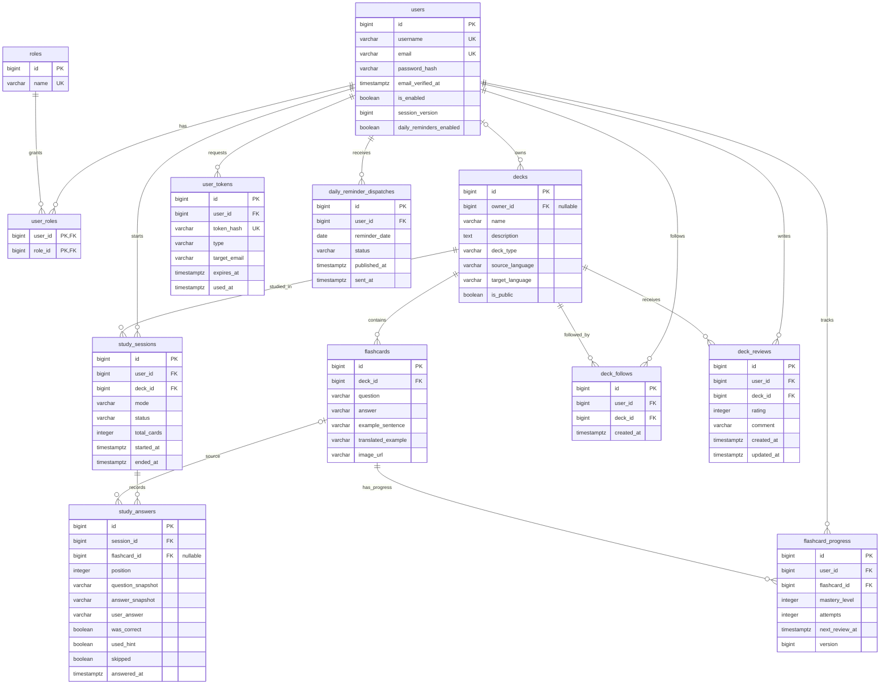

- Nazwy kont i e-maile są unikalne niezależnie od wielkości liter dzięki indeksom `LOWER(...)`.
- Para użytkownik–talia jest unikalna w obserwacjach i recenzjach, a użytkownik–fiszka w postępie nauki.
- `study_answers` przechowuje kopię treści fiszki z początku sesji i tekst odpowiedzi użytkownika. Usunięcie fiszki nie usuwa historycznej odpowiedzi; jej `flashcard_id` staje się `NULL`.
- Usunięcie konta usuwa jego prywatne talie i dane użytkownika. Publiczne talie pozostają z `owner_id = NULL` i są wyświetlane jako **Deleted user**.
- Recenzje pozostają po przełączeniu talii na prywatną. Właściciel może je odczytać, a administrator moderować; inni użytkownicy nie uzyskują przez to dostępu do prywatnej talii.
- Flyway zarządza schematem. Hibernate nie tworzy ani nie aktualizuje tabel w uruchomieniu aplikacji.

## Authentication i authorization

- Logowanie korzysta z sesji Spring Security i cookie `JSESSIONID` z `HttpOnly` oraz `SameSite=Lax`. Po zalogowaniu identyfikator sesji jest zmieniany. Aplikacja nie przechowuje JWT w `localStorage`.
- Hasła są hashowane BCrypt. Serwer waliduje długość, w tym limit 72 bajtów UTF-8; hasła nie są przycinane.
- Rejestracja nadaje wyłącznie rolę USER. Administrator ma dodatkowo ADMIN.
- Frontend odtwarza użytkownika przez `/api/auth/me`, chroni trasy i ukrywa panel administratora przed USER. Backend niezależnie sprawdza uprawnienia — ukrycie przycisku nie zastępuje autoryzacji.
- Operacje na własnych zasobach sprawdzają właściciela; `/api/admin/**` wymaga ADMIN. Sesje są unieważniane m.in. przy zmianie hasła i uprawnień.
- CSRF pozostaje aktywne także dla publicznych POST, np. rejestracji i logowania. Frontend przesyła token w `X-CSRF-TOKEN` przy operacjach zmieniających dane.
- Zmiana e-maila wymaga potwierdzenia nowego adresu. Do tego czasu działa stary adres. Zmiana hasła unieważnia również oczekującą zmianę e-maila.
- Motyw i język są zapamiętywane lokalnie w przeglądarce; nie stanowią źródła informacji o zalogowaniu.

## Reguły biznesowe

1. **Dostęp do nauki:** można uczyć się własnej talii albo obserwowanej publicznej talii. Pusta talia nie pozwala rozpocząć sesji.
2. **Tryby nauki:** Scheduled Review wybiera fiszki wymagające powtórki; Free Practice losuje do 10 fiszek bez zmiany ich poziomu opanowania i terminu powtórki. Oba tryby mają limit 10 fiszek. Study Again zachowuje tryb, a Free Practice losuje ponownie.
3. **Odpowiedzi i XP:** odpowiedzi alternatywne zapisuje się po przecinku. Wystarczy jeden wariant; porównanie ignoruje wielkość liter i skrajne spacje. Literówki i brak polskich znaków nie są automatycznie akceptowane. Poprawna odpowiedź daje 10 XP, po Hint 5 XP, błędna lub Skip 0 XP.
4. **Kolejność sesji:** można odpowiedzieć tylko na bieżącą fiszkę, a zakończyć sesję po zapisaniu wszystkich odpowiedzi. Powtórne wysłanie tej samej zapisanej odpowiedzi nie nalicza postępu drugi raz.
5. **Recenzje:** tylko publiczna talia, jedna recenzja danego użytkownika na talię, zakaz oceniania własnej; ocena 1–5 i opcjonalny komentarz do 1000 znaków. Własną recenzję można edytować/usunąć, administrator może usuwać recenzje w ramach moderacji.
6. **Ochrona administratora:** operacje administracyjne chronią ostatniego aktywnego administratora przed utratą dostępu.
7. **Import:** najpierw analiza, potem potwierdzenie i ponowna walidacja po stronie serwera. Wszystkie poprawne wiersze są zapisywane w jednej transakcji; błędny import nie zapisuje części fiszek.
8. **Cel dzienny i streak:** cel to 20 zapisanych odpowiedzi dziennie. Streak opiera się na kolejnych dniach osiągnięcia celu; statystyki domyślnie używają strefy `Europe/Warsaw`.

## Dokumentacja REST API

Pełne endpointy, DTO, parametry, odpowiedzi i wymagania autoryzacji są generowane z backendu:

- [Swagger UI](http://localhost:8080/swagger-ui/index.html)
- [OpenAPI JSON](http://localhost:8080/v3/api-docs)
- [OpenAPI YAML](http://localhost:8080/v3/api-docs.yaml)

### Jak wykonać żądanie w Swaggerze

1. Otwórz Swagger na `localhost:8080`.
2. Wykonaj GET `/api/auth/csrf` i skopiuj pole `token` z odpowiedzi.
3. Kliknij **Authorize** i wklej token do **CsrfToken**. Pole **SessionCookie** pozostaw puste — cookie obsługuje przeglądarka.
4. Wykonaj POST `/api/auth/login` z danymi własnego potwierdzonego konta:

   ```json
   {
     "login": "twoja_nazwa_uzytkownika",
     "password": "<twoje hasło>"
   }
   ```

5. Po logowaniu ponownie pobierz GET `/api/auth/csrf` i zaktualizuj **CsrfToken**, ponieważ logowanie rotuje token.
6. Testuj endpointy. Przeglądarka automatycznie przesyła cookie sesji. Po wylogowaniu lub zmianie sesji pobierz nowy CSRF. Do `/api/admin/**` użyj konta ADMIN.

Swagger wykonuje operacje na bazie uruchomionej aplikacji, tak samo jak frontend. Sesja uwierzytelnia użytkownika, a token CSRF chroni żądanie przed wymuszeniem — sam token CSRF nie loguje.

### Najważniejsze endpointy

W tabeli pominięto część operacji; pełny kontrakt jest w Swaggerze. `id`, `deckId`, `cardId` i `reviewId` oznaczają rzeczywiste identyfikatory zasobów.

| Metoda i ścieżka | Operacja |
| --- | --- |
| GET `/api/status` | Status aplikacji i bazy. |
| POST `/api/auth/register`, `/api/auth/verify-email` | Rejestracja i potwierdzenie konta. |
| GET `/api/auth/csrf` | Pobranie tokenu CSRF. |
| POST `/api/auth/login`, `/api/auth/logout` | Logowanie i wylogowanie. |
| GET `/api/auth/me` | Bieżący użytkownik. |
| POST `/api/auth/forgot-password`, `/api/auth/reset-password` | Odzyskiwanie dostępu. |
| GET, POST `/api/decks` | Lista własnych talii i utworzenie talii. |
| GET, PUT, DELETE `/api/decks/{deckId}` | Szczegóły, edycja i usunięcie własnej talii. |
| GET, POST `/api/decks/{deckId}/flashcards` | Lista i dodawanie fiszek. |
| PUT, DELETE `/api/decks/{deckId}/flashcards/{cardId}` | Edycja i usunięcie fiszki. |
| GET `/api/decks/{deckId}/flashcards/export` | Eksport całej talii do CSV. |
| POST `/api/decks/{deckId}/flashcards/import/preview`, `/api/decks/{deckId}/flashcards/import` | Analiza CSV i potwierdzony import. |
| GET `/api/explore/decks`, `/api/explore/decks/{deckId}` | Publiczne talie i szczegóły. |
| PUT, DELETE `/api/explore/decks/{deckId}/follow` | Follow i Unfollow. |
| GET, POST `/api/explore/decks/{deckId}/reviews` | Lista recenzji i dodawanie opinii. |
| PUT, DELETE `/api/explore/decks/{deckId}/reviews/{reviewId}` | Edycja i usunięcie własnej recenzji. |
| GET `/api/decks/{deckId}/reviews` | Recenzje własnej talii, także prywatnej. |
| POST `/api/decks/{deckId}/study-sessions` | Start sesji z `mode`: `SCHEDULED_REVIEW` albo `FREE_PRACTICE`. |
| GET `/api/study-sessions/{id}` | Stan własnej sesji. |
| POST `/api/study-sessions/{id}/answers/{answerId}` | Wpisana odpowiedź albo Skip. |
| POST `/api/study-sessions/{id}/answers/{answerId}/hint` | Podpowiedź. |
| POST `/api/study-sessions/{id}/complete` | Zakończenie sesji. |
| GET `/api/study-sessions/{id}/summary` | Podsumowanie. |
| GET `/api/statistics/me`, `/api/statistics/me/decks`, `/api/statistics/me/decks/{deckId}` | Statystyki użytkownika i opanowanie talii. |
| GET `/api/admin/users`, `/api/admin/decks`, `/api/admin/reviews` | Listy administracyjne z paginacją. |
| PUT `/api/admin/users/{id}/enabled` | Blokowanie/odblokowanie konta. |
| PUT, DELETE `/api/admin/users/{id}`, `/api/admin/decks/{id}` | Edycja i usuwanie użytkowników oraz publicznych talii. |
| DELETE `/api/admin/reviews/{reviewId}` | Moderacja recenzji. |

Listy z paginacją przyjmują `page` liczone od zera oraz `size`. Przykład: GET `/api/explore/decks?page=0&size=5`. Parametry wyszukiwania, filtrów i dopuszczalne rozmiary są opisane przy operacjach w Swaggerze. Nie każdy endpoint listujący stosuje paginację — np. zestawienie mastery talii jest osobnym agregatem.

### Błędy API

Przykładowa odpowiedź walidacji:

```json
{
  "timestamp": "2026-11-20T10:00:00Z",
  "status": 400,
  "error": "Bad Request",
  "message": "Please check the submitted fields.",
  "path": "/api/explore/decks/1/reviews",
  "fieldErrors": {
    "rating": "Choose a whole-star rating from 1 to 5."
  }
}
```

Główne statusy: `200` odczyt/edycja, `201` utworzenie, `202` przyjęcie żądania np. odzyskania dostępu, `204` sukces bez body, `400` niepoprawne dane, `401` brak sesji, `403` brak uprawnień lub błąd CSRF, `404` brak/niedostępny zasób, `409` konflikt reguły biznesowej, `413` zbyt duży import. Kontrolery używają wspólnego `GlobalExceptionHandler`, a filtry Security własnego handlera zwracającego ten sam format błędu. Frontend obsługuje błędy pól, sieci, stan wysyłania oraz potwierdzony sukces.

## Import i eksport CSV

W szczegółach własnej talii wybierz **Import CSV**, pobierz przykład lub wskaż plik, obejrzyj podgląd i potwierdź **Import flashcards**. Podgląd sam nie zapisuje danych. **Export CSV** pobiera wszystkie fiszki własnej talii, niezależnie od paginacji widoku.

Format: UTF-8, separator przecinek i nagłówek. `question` i `answer` są wymagane, pozostałe kolumny opcjonalne:

```csv
question,answer,example_sentence,translated_example,image_url
habit,"nawyk, przyzwyczajenie",I have a good habit.,Mam dobry nawyk.,
```

W trakcie nauki wystarczy wpisać `nawyk` albo `przyzwyczajenie`. Pole zawierające przecinek otacza się podwójnym cudzysłowem; cudzysłów wewnątrz pola zapisuje się jako `""`.

- Maksymalnie **1 MiB** i **1000 fiszek** na import.
- Pytanie i odpowiedź: do 2000 znaków, przykładowe zdanie i tłumaczenie: do 1000, link obrazu: do 2048.
- `image_url` jest opcjonalnym linkiem HTTP(S), nie przesyłanym plikiem obrazu.
- Ponowny import tego samego pliku dodaje kolejne fiszki; import nie usuwa istniejących i nie deduplikuje treści.
- Import i eksport działają synchronicznie przez REST API. RabbitMQ obsługuje pocztę, nie CSV.
- Plik przykładowy w repozytorium: [flashcards-example.csv](frontend/src/assets/examples/flashcards-example.csv).

## Testy i CI

### Backend

Do lokalnego uruchomienia testów potrzebne są **JDK 25** (poprawne `JAVA_HOME`) i działający Docker. Maven jest dostarczony przez Wrapper.

PowerShell, z katalogu głównego:

```powershell
cd backend
.\mvnw.cmd test
```

Bash:

```bash
cd backend
bash ./mvnw test
```

Testy obejmują reguły nauki i XP, rejestrację, uprawnienia, CRUD, recenzje, import CSV, statystyki i obsługę błędów. Testy REST wykonują żądania z sesją i CSRF. Testcontainers uruchamia osobny PostgreSQL, wykonuje migracje i sprząta kontener po zakończeniu; testy nie używają bazy aplikacji ani jej `.env`. Integracyjne testy poczty symulują publikację/wysyłkę i nie wymagają ręcznie uruchomionych usług Compose.

Raporty znajdują się w `backend/target/surefire-reports/`. Ostatni pełny lokalny przebieg z 19 listopada 2026: **255 testów, 0 błędów, 0 niepowodzeń, 0 pominiętych**. To zapis tamtej weryfikacji, nie automatyczne potwierdzenie każdej późniejszej zmiany. Obraz backendu buduje się z `-DskipTests`, więc samo powodzenie `docker compose build` nie zastępuje testów.

### Frontend

Potrzebny jest Node.js 24 i npm. Z katalogu głównego:

```shell
cd frontend
npm ci
npm run build
npm run lint
```

W PowerShell, jeśli polityka uruchamiania blokuje `npm.ps1`, użyj `npm.cmd`. Build sprawdza TypeScript i buduje aplikację; lint sprawdza kod ESLintem. Projekt nie ma skonfigurowanego stałego zestawu testów E2E przeglądarki. Formularze i układ wymagają także ręcznego sprawdzenia.

### GitHub Actions

- [Backend CI](.github/workflows/backend-ci.yml): Java 25, Maven, testy z Testcontainers, raporty Surefire jako artefakt przy błędzie.
- [Frontend CI](.github/workflows/frontend-ci.yml): Node 24, `npm ci`, build i lint.
- Oba workflow uruchamiają się przy pull requestach, pushu na `main` oraz ręcznie przez **Run workflow**.


## Film
[Obejrzyj prezentację aplikacji](https://youtu.be/U6g3Dd3tZ00)


## Zrzuty ekranu

### Strona startowa


### Strona logowania

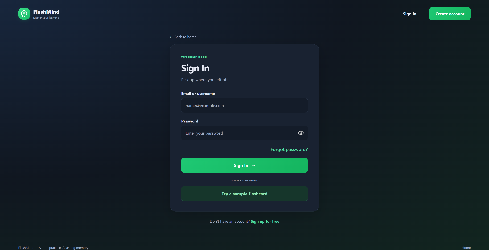

### Dashboard

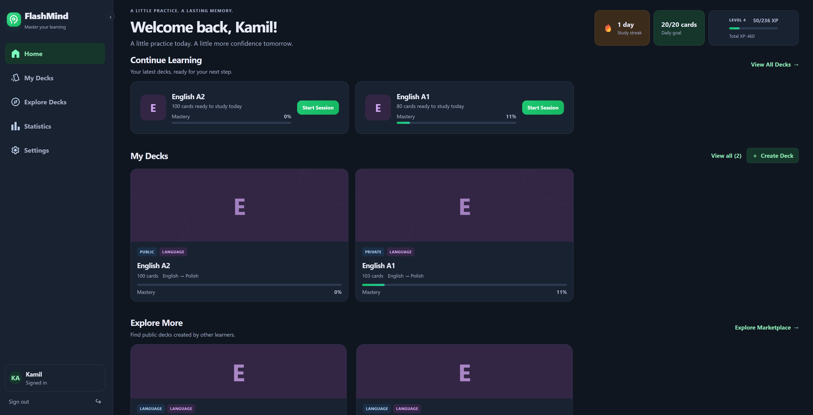

### Moje talie

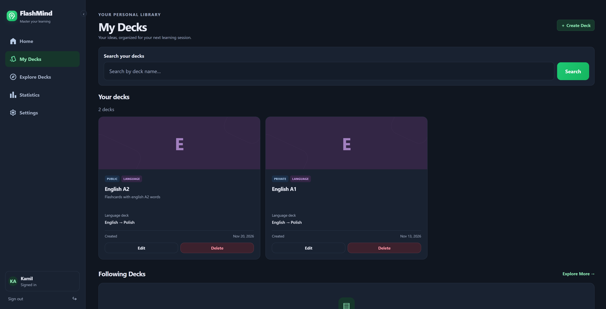

### Widok talii fiszek

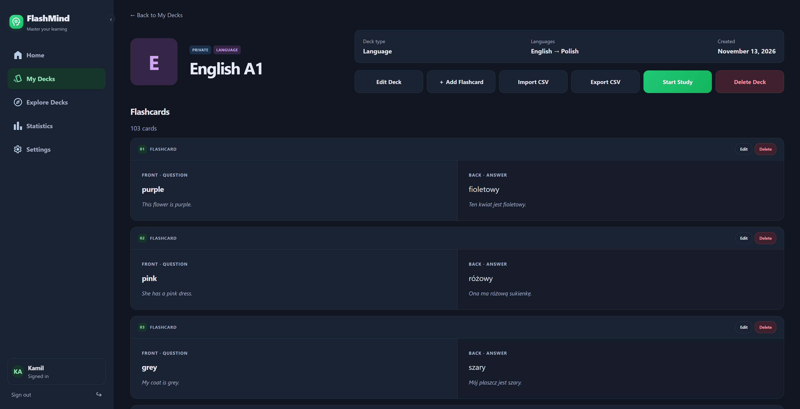

### Opinie o talii

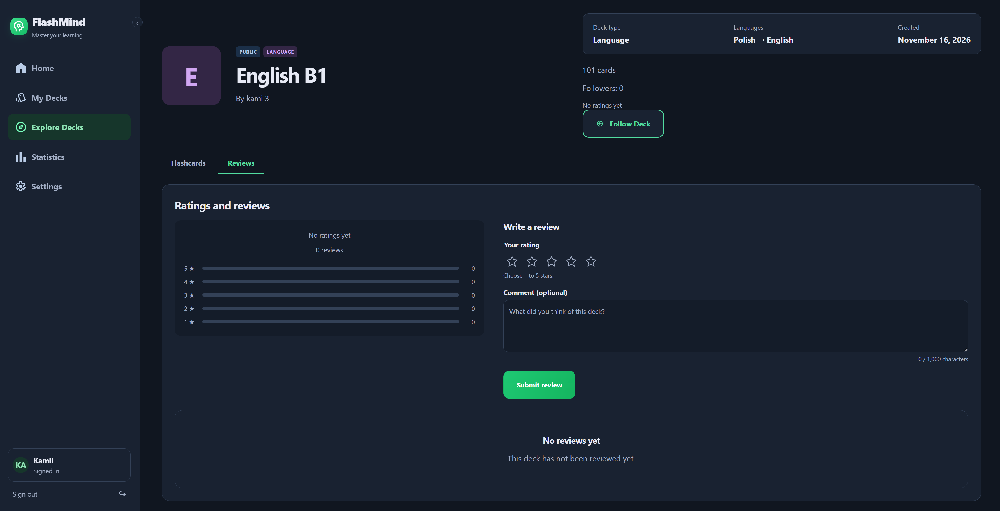

### Sesja nauki

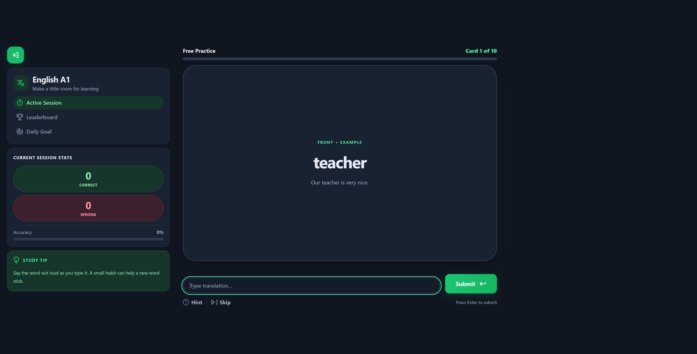

### Explore decks

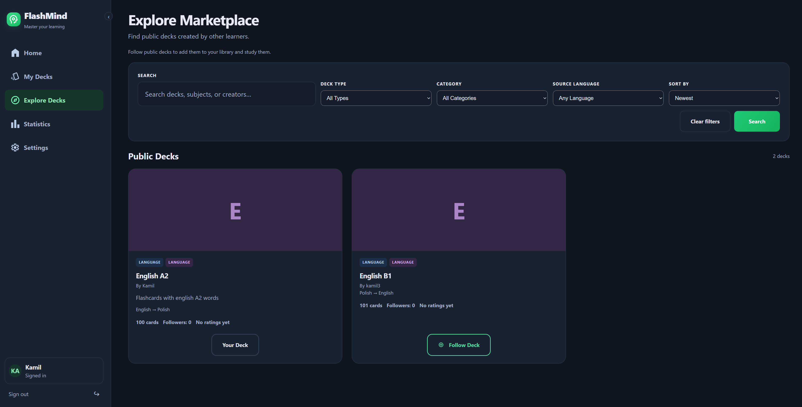

### Statystyki

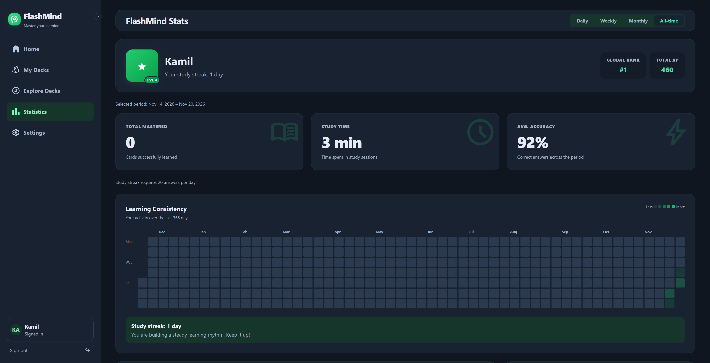
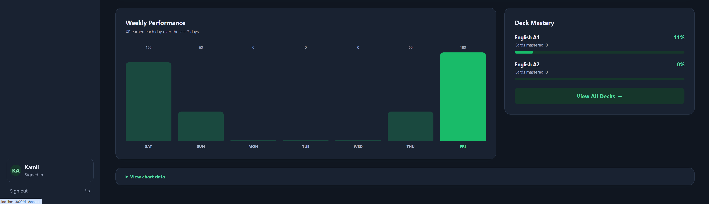

### Ustawienia

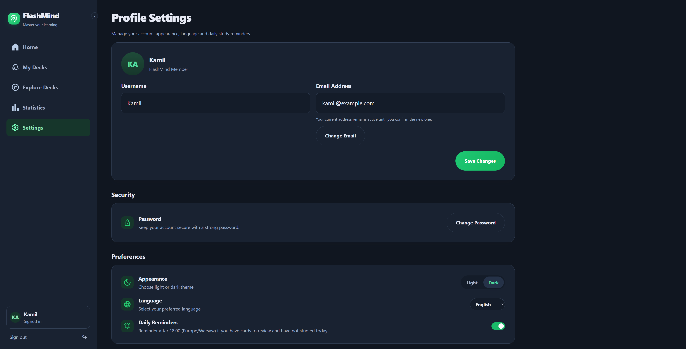

### Panel Admina

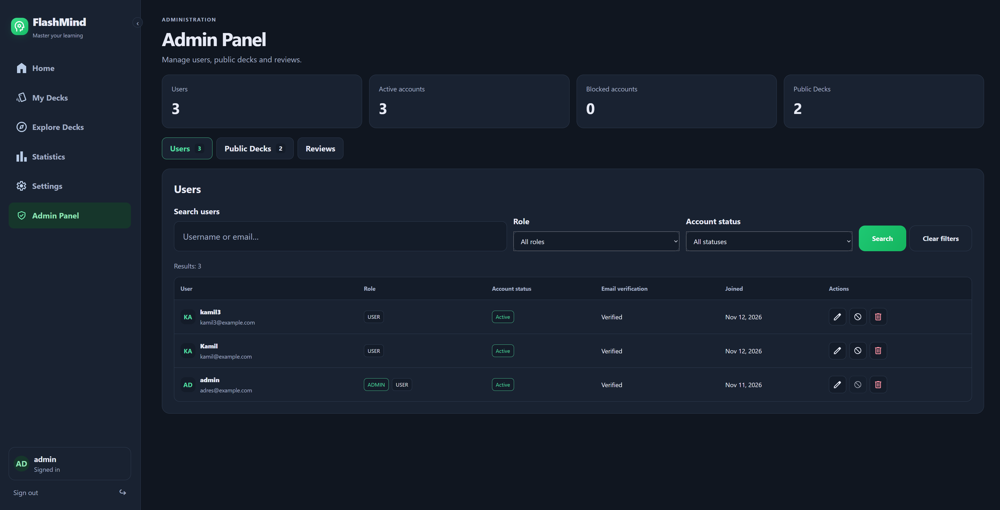